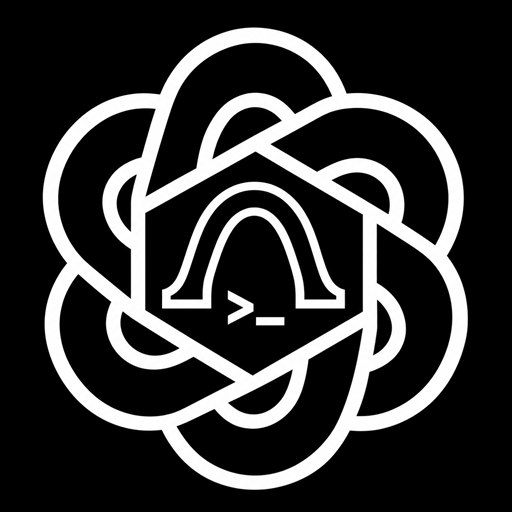

<p align="center">
  
</p>

# Antigravity ↔ Codex Bridge

A zero-dependency, **bidirectional** Model Context Protocol (MCP) plugin that lets **Google Antigravity** and **OpenAI Codex CLI** delegate work to each other—either in a strict master/worker hierarchy or freely back and forth as peers with built-in workspace, concurrency, recursion, and agent-level cycle protection.

- **Antigravity → Codex (`codex-local`)**: Antigravity delegates scoped implementation, code review, or parallel tasks in operator-approved workspaces to your local `@openai/codex` CLI (`codex exec --json`, `resume`, `fork`, `review`).
- **Codex → Antigravity (`antigravity-local`)**: Codex delegates research, planning, editing, or structured-output tasks to your local Google Antigravity CLI (`agy --input-format stream-json --output-format stream-json`).
- **Independent direction controls**: Enable or disable either direction independently with a single shared policy file (`bridge.config.json`), CLI configurator (`scripts/configure.mjs`), or environment variables—no restart required.
- **Explicit agent-to-agent attribution**: Both directions prepend an `AGENT-TO-AGENT DELEGATION` header identifying the sending and receiving agents so delegated models never confuse agent instructions with direct human prompts.

> **Why a bundled MCP bridge?** Newer releases of `@openai/codex` removed the legacy `codex mcp-server` subcommand, and `agy` runs headless via NDJSON streams. Both servers here are pure Node.js ESM (`>= 18`), require zero `npm install`, reuse your existing local logins/configs, and share a unified loop-guard policy layer.

---

## Delegation Topologies

Configure the exact hierarchy you want via `node scripts/configure.mjs`:

| Topology | Preset Command | `antigravity_to_codex` | `codex_to_antigravity` | `max_depth` | `allow_cycles` | Behavior |
| :--- | :--- | :---: | :---: | :---: | :---: | :--- |
| **Antigravity Master** *(default)* | `--mode agy-master` | `true` | `false` | `1` | `false` | Antigravity delegates to Codex; Codex cannot call back to Antigravity. |
| **Codex Master** | `--mode codex-master` | `false` | `true` | `1` | `false` | Codex delegates to Antigravity; Antigravity cannot call back to Codex. |
| **Bidirectional Peers** | `--mode bidirectional` | `true` | `true` | `1` | `false` | Either tool can initiate one-hop delegation (no ping-pong callbacks by default). |
| **Bidirectional Callbacks** | `--mode bidirectional --max-depth 2 --allow-cycles on` | `true` | `true` | `2` | `true` | Either model can initiate and delegate back (`A → B → A`) up to `max_depth` hops. |
| **Both Disabled** | `--mode off` | `false` | `false` | `0` | `false` | Both servers stay healthy (`initialize`/`ping`) while exposing no tools. |

You can also toggle each direction, `max_depth`, and `allow_cycles` independently (see [Configuring Directions & Loop Protection](#configuring-directions--loop-protection)).

---

## Prerequisites

Install whichever CLIs correspond to the direction(s) you plan to enable:

1. **Node.js 18+** (`node --version`)
2. **For Antigravity → Codex (`codex-local`)**:
   ```bash
   npm install -g @openai/codex
   codex --version
   codex login
   ```
3. **For Codex → Antigravity (`antigravity-local`)**:
   - **macOS / Linux**:
     ```bash
     curl -fsSL https://antigravity.google/cli/install.sh | bash
     agy --version
     ```
   - **Windows (PowerShell)**:
     ```powershell
     irm https://antigravity.google/cli/install.ps1 | iex
     agy --version
     ```
   - Authenticate once via an interactive `agy` session (or Antigravity App—credentials are shared locally).

---

## Installation

### 1. Clone the plugin into Antigravity's global plugins folder

**macOS / Linux:**
```bash
mkdir -p ~/.gemini/config/plugins
git clone https://github.com/zbush/antigravity-codex-plugin.git ~/.gemini/config/plugins/codex
```

**Windows (PowerShell):**
```powershell
New-Item -ItemType Directory -Force -Path "$env:USERPROFILE\.gemini\config\plugins" | Out-Null
git clone https://github.com/zbush/antigravity-codex-plugin.git "$env:USERPROFILE\.gemini\config\plugins\codex"
```

This immediately enables **Direction A (Antigravity → Codex)** in Antigravity (`Customizations → Plugins → Antigravity <-> Codex Bridge`).

### 2. Wire Direction B (Codex → Antigravity) *(optional)*

Run the built-in configurator from the installed plugin checkout to register `antigravity-local` in Codex (`~/.codex/config.toml`), configure `env_vars` forwarding for the loop guard, and choose your starting mode. If you wired Codex on an older version, rerun `node scripts/configure.mjs --wire-codex` from that checkout and restart the host to pick up `AGENT_BRIDGE_MAX_CONCURRENT` and `AGENT_BRIDGE_INHERITED_POLICY` forwarding.

```bash
cd ~/.gemini/config/plugins/codex

# Example 1: Bidirectional peer mode (1 hop from either side)
node scripts/configure.mjs --mode bidirectional --wire-codex --status

# Example 2: Bidirectional with back-and-forth callbacks (A -> B -> A)
node scripts/configure.mjs --mode bidirectional --max-depth 2 --allow-cycles on --wire-codex --status

# Example 3: Strict Codex-master hierarchy (Codex -> Antigravity only)
node scripts/configure.mjs --mode codex-master --wire-codex --status
```

<details>
<summary><strong>Manual Codex registration (alternative to <code>--wire-codex</code>)</strong></summary>

Register the server with `codex mcp add`:
```bash
codex mcp add antigravity-local -- node /absolute/path/to/.gemini/config/plugins/codex/server/antigravity-mcp.mjs
```

Then add `env_vars` under `[mcp_servers.antigravity-local]` in `~/.codex/config.toml` so delegation depth and policy overrides cross Codex's MCP boundary:
```toml
[mcp_servers.antigravity-local]
command = "node"
args = ["/absolute/path/to/.gemini/config/plugins/codex/server/antigravity-mcp.mjs"]
env_vars = [
  "AGENT_BRIDGE_CONTEXT",
  "AGENT_BRIDGE_WORKSPACE_ROOTS",
  "AGENT_BRIDGE_ALLOW_EDITS",
  "AGENT_BRIDGE_CODEX_WINDOWS_SANDBOX",
  "AGENT_BRIDGE_DEPTH",
  "AGENT_BRIDGE_MAX_DEPTH",
  "AGENT_BRIDGE_MAX_CONCURRENT",
  "AGENT_BRIDGE_CHAIN",
  "AGENT_BRIDGE_CONFIG",
  "AGENT_BRIDGE_INHERITED_POLICY",
  "AGENT_BRIDGE_ANTIGRAVITY_TO_CODEX",
  "AGENT_BRIDGE_CODEX_TO_ANTIGRAVITY",
  "AGENT_BRIDGE_ALLOW_CYCLES",
  "AGY_BIN",
  "CODEX_BIN",
  "CODEX_CLI_JS",
]
```
</details>

To remove `antigravity-local` from Codex later:
```bash
node scripts/configure.mjs --unwire-codex
```

---

## Configuring Directions & Loop Protection

### Config file & precedence

User policy is stored outside the plugin install folder so `git pull` or plugin updates never overwrite your preferences:
- **Default user policy file**: `~/.gemini/config/antigravity-codex-bridge/bridge.config.json`
- **Shipped defaults**: `./bridge.config.json` (`antigravity_to_codex: true`, `codex_to_antigravity: false`, `max_depth: 1`, `max_concurrent: 4`, `allow_cycles: false`)

When you supply a config path via `AGENT_BRIDGE_CONFIG` or `--config`, that path must be absolute and nonblank. Passing `--config` to `scripts/configure.mjs` selects its target file ahead of `AGENT_BRIDGE_CONFIG`. At runtime, an explicit config path pointing to a missing file fails closed.

Both servers reload the operator config live on every `tools/list` and `tools/call` in the precedence order below. On delegated hops, the child intersects that operator config with `AGENT_BRIDGE_INHERITED_POLICY` before admitting a handoff.

```text
Environment variables  >  User bridge.config.json (or AGENT_BRIDGE_CONFIG)  >  Shipped bridge.config.json  >  Built-in defaults
```

### CLI configurator (`scripts/configure.mjs`)

Unspecified flags preserve your existing settings:

```bash
# Inspect effective policy and Codex MCP registration
node scripts/configure.mjs --status

# Switch presets
node scripts/configure.mjs --mode agy-master
node scripts/configure.mjs --mode codex-master
node scripts/configure.mjs --mode bidirectional
node scripts/configure.mjs --mode off

# Toggle directions independently
node scripts/configure.mjs --antigravity-to-codex on --codex-to-antigravity off
node scripts/configure.mjs --codex-to-antigravity on --max-depth 2

# Allow multi-hop back-and-forth (e.g., A -> B -> A -> B up to 4 hops)
node scripts/configure.mjs --mode bidirectional --max-depth 4 --allow-cycles on
```

### Policy schema (`bridge.config.json`)

```json
{
  "version": 1,
  "directions": {
    "antigravity_to_codex": true,
    "codex_to_antigravity": true
  },
  "max_depth": 1,
  "max_concurrent": 4,
  "allow_cycles": false
}
```

### How live policy & loop guards work

1. **Disabled direction**: The server still responds to `initialize` and `ping`, returns an empty `tools: []` list (emitting `notifications/tools/list_changed` if disabled live), cancels owned jobs, and rejects any cached `tools/call` with JSON-RPC error `-32602` (`data.reason: "direction_disabled"`).
2. **Depth, agent-level cycles, concurrency, and inherited limits.** Each parent forwards `AGENT_BRIDGE_CONTEXT`, the incremented `AGENT_BRIDGE_DEPTH`, the updated `AGENT_BRIDGE_CHAIN`, and its effective policy in `AGENT_BRIDGE_INHERITED_POLICY`. A child can use a direction only when both inherited and current operator settings enable it. The lower `max_depth` and `max_concurrent` apply, and both policies must permit cycles.
   - `depth = 0` is a top-level user session.
   - When `depth >= max_depth` or `remaining_hops === 0`, launch tools (`*_run`, `*_spawn`, `*_resume`, `*_fork`, `*_review`) are hidden and rejected (`data.reason: "max_depth_reached"`), while `*_status`, `*_job_status`, and `*_job_cancel` remain available.
   - When `allow_cycles` is `false` (default), delegating back to an agent that already sent an earlier hop in the chain is blocked (`data.reason: "cycle_blocked"`). That permits 3-agent non-cyclic chains (such as `Antigravity → Codex → Claude` when `max_depth >= 2`) while blocking `A → B → A` callbacks unless you explicitly enable `allow_cycles: true` with `max_depth >= 2`.
   - When active child jobs reach `max_concurrent` (default `4`), new launches are refused (`data.reason: "max_concurrent_reached"`) until a running job completes or is cancelled.
3. **Request cancellation (`notifications/cancelled`)**: Cancelling a synchronous `*_run`, `*_resume`, `*_fork`, or `*_review` MCP call immediately terminates the spawned CLI process tree.
4. **Fail-closed validation.** A nonzero `AGENT_BRIDGE_DEPTH` without `AGENT_BRIDGE_INHERITED_POLICY` (unless entering fresh from a foreign bridge via `AGENT_BRIDGE_CONTEXT`) refuses the launch. The bridge also fails closed on malformed JSON, invalid policy values, blank or relative `AGENT_BRIDGE_CONFIG` paths, missing explicit `AGENT_BRIDGE_CONFIG` files at runtime, and inconsistent `AGENT_BRIDGE_DEPTH` and `AGENT_BRIDGE_CHAIN` values.

### Environment variable overrides

All three bridges pass `AGENT_BRIDGE_CONTEXT` through the host environment as a version 1 JSON object containing ordered `hops` (`from`, `to`, and a unique `id`) and `remaining_hops`. Each handoff spends one hop and applies the smaller of the incoming budget and the local limit. A handoff entering from the Claude bridge can start this pair's local policy history; a returning handoff that previously used this pair must carry its inherited policy. Run `node scripts/configure.mjs --wire-codex` to refresh existing Codex forwarding.

| Variable | Values | Purpose |
| :--- | :--- | :--- |
| `AGENT_BRIDGE_CONFIG` | Nonblank absolute file path | Shared override path for runtime and `scripts/configure.mjs`. Missing explicit files fail closed at runtime, and `--config` selects the configurator target ahead of this variable. |
| `AGENT_BRIDGE_ANTIGRAVITY_TO_CODEX` | `true` / `false` (`on`/`off`) | Override Antigravity → Codex direction. |
| `AGENT_BRIDGE_CODEX_TO_ANTIGRAVITY` | `true` / `false` (`on`/`off`) | Override Codex → Antigravity direction. |
| `AGENT_BRIDGE_MAX_DEPTH` | Integer `0..10` | Maximum delegated hop depth. |
| `AGENT_BRIDGE_MAX_CONCURRENT` | Integer `>= 1` (default `4`) | Maximum concurrent active child CLI jobs per server. |
| `AGENT_BRIDGE_ALLOW_CYCLES` | `true` / `false` (`on`/`off`) | Allow delegating back to an agent already in the chain up to `max_depth`. |
| `CODEX_BIN` | Absolute file path | Explicit `codex` executable (`.exe` on Windows; `.cmd`/`.bat` shims are refused—use `CODEX_CLI_JS` for npm installs). |
| `CODEX_CLI_JS` | Absolute file path | Explicit `@openai/codex/bin/codex.js` path (run directly via `process.execPath`). |
| `AGENT_BRIDGE_CODEX_WINDOWS_SANDBOX` | `mxc`, `elevated`, `unelevated` | Select the Windows sandbox backend provisioned on this machine when delegated Codex sessions need it for shell commands. |
| `AGY_BIN` | Absolute file path | Explicit `agy` executable (`.exe` or `.js` on Windows; `.cmd`/`.bat` shims are refused). Defaults auto-check `%LOCALAPPDATA%\agy\bin\agy.exe`, `~/.local/bin/agy`, Homebrew, and `PATH`. |

---

### Workspace and edit permissions

Set `AGENT_BRIDGE_WORKSPACE_ROOTS` in each host's MCP registration to a JSON array of absolute directories, for example `["/home/me/projects"]`. The bridge resolves symlinks and checks `cwd` and every `add_dirs` entry against those roots before launch. If the setting is absent, the server uses its startup directory. A server started at a volume root requires explicit roots.

Codex starts read-only (`sandbox: "read-only"`). To request `workspace-write`, the operator must set `AGENT_BRIDGE_ALLOW_EDITS` to the string `true`. The isolated CLI loads the paired `antigravity-local` server only when a return hop is permitted (`allow_cycles: true`, reverse direction enabled, depth remaining) and the standard registration from `--wire-codex` is enabled; it skips customized registrations with additional tool, approval, or environment settings. Its callback inherits the narrowed workspace directories and edit setting. For parallel edits, prepare separate worktrees inside approved roots and pass each as `cwd`.

Antigravity CLI tasks require `AGENT_BRIDGE_ALLOW_EDITS=true` on the host because the CLI can edit files even when asked to plan. Each task starts a fresh sandboxed session with slash commands disabled, in `plan` mode unless the caller selects `accept-edits`. When `mode` is `plan`, the bridge narrows `AGENT_BRIDGE_ALLOW_EDITS` to `false` in the child's environment so a plan-mode turn cannot delegate writes back to Codex.

## MCP Tool Reference

### Antigravity → Codex (`codex-local`)

| Tool | Description |
| :--- | :--- |
| `codex_status` | Read-only diagnostic reporting resolved Codex binary & source (or `binary_error`), `codex --version`, active bridge policy, workspace policy, and active/max concurrent job capacity. |
| `codex_run` | Run a scoped local Codex task synchronously (`prompt`, `cwd`, `sandbox`, `model`, `add_dirs`, `skip_git_repo_check`, `ephemeral`, `timeout_seconds`) and return `session_id`, response, commands run, and token usage. Outputs are capped at 4 MiB. |
| `codex_resume` | Continue a completed session started by this bridge in the same workspace (`session_id` or `last: true`; pass `sandbox: "workspace-write"` when resuming a write session). |
| `codex_fork` | Fork a completed session started by this bridge in the same workspace (`session_id`; pass `sandbox: "workspace-write"` when forking a write session). |
| `codex_review` | Run a non-interactive code review against uncommitted changes, a `base` branch, or a `commit` SHA. |
| `codex_spawn` | Start a Codex task (`run`/`resume`/`fork`/`review`) in the background and return a `job_id` immediately (recommended for parallel workers or tasks > ~2 minutes). |
| `codex_job_status` | Inspect a background `job_id` or list all tracked Codex jobs (full outputs retained for the latest 50 finished jobs). |
| `codex_job_cancel` | Terminate a running background Codex job and its process tree. |

### Codex → Antigravity (`antigravity-local`)

| Tool | Description |
| :--- | :--- |
| `antigravity_status` | Read-only diagnostic reporting resolved `agy` binary & source (or `binary_error`), `agy --version`, active bridge policy, workspace policy, and active/max concurrent job capacity. |
| `antigravity_run` | Run a local Antigravity CLI turn synchronously (`prompt`, `cwd`, `model`, `effort`, `mode`, `add_dirs`, `sandbox`, `disable_slash_commands`, `json_schema`, `timeout_seconds`) and return `conversation_id`, response, `structured_output`, and token usage. |
| `antigravity_spawn` | Start a background Antigravity turn and return a `job_id` immediately for parallel fan-out or long tasks. |
| `antigravity_job_status` | Inspect a background `job_id` or list all tracked Antigravity jobs (full outputs retained for the latest 50 finished jobs). |
| `antigravity_job_cancel` | Terminate a running background Antigravity job and its process tree. |

---

## Non-PATH / Version Manager Setup (`nvm`, `fnm`, `volta`, Homebrew)

By default, `mcp_config.json` uses portable defaults (`command: "node"`, `args: ["server/index.mjs"]`) because Antigravity runs plugin MCP servers with `cwd` set to the plugin root.

On Windows, automatic discovery checks `%LOCALAPPDATA%\agy\bin\agy.exe`, `~/.local/bin/agy.exe`, and `PATH` for `agy.exe`, and discovers `@openai/codex/bin/codex.js` (relative to Node, `NPM_CONFIG_PREFIX`, `%APPDATA%\npm`, or `PATH`) or `codex.exe` without ever invoking `cmd.exe` batch shims. When a desktop or GUI host omits your shell `PATH`, pin explicit paths in your local `~/.gemini/config/plugins/codex/mcp_config.json`:

<details>
<summary><strong>Windows example (nvm-windows)</strong></summary>

```json
{
  "mcpServers": {
    "codex-local": {
      "command": "C:\\nvm4w\\nodejs\\node.exe",
      "args": [
        "C:\\Users\\<YOUR_USER>\\.gemini\\config\\plugins\\codex\\server\\index.mjs"
      ],
      "env": {
        "CODEX_CLI_JS": "C:\\nvm4w\\nodejs\\node_modules\\@openai\\codex\\bin\\codex.js"
      }
    }
  }
}
```
</details>

<details>
<summary><strong>macOS / Linux example (nvm or Homebrew)</strong></summary>

```json
{
  "mcpServers": {
    "codex-local": {
      "command": "/Users/<YOUR_USER>/.nvm/versions/node/v22.x.x/bin/node",
      "args": [
        "/Users/<YOUR_USER>/.gemini/config/plugins/codex/server/index.mjs"
      ],
      "env": {
        "CODEX_BIN": "/opt/homebrew/bin/codex"
      }
    }
  }
}
```
</details>

---

## Testing & Verification

Run the built-in zero-dependency test suite (covers config precedence, live toggling, depth/agent-cycle/concurrency guards, both MCP servers over stdio, status diagnostics, request cancellation, timeouts, output caps, and Codex wiring):

```bash
npm test
# or directly:
node --test tests/bridge.test.mjs
```

### Troubleshooting

- **Synchronous MCP call times out after ~3 minutes**: Some MCP hosts enforce a ~3-minute per-call timeout. Use `codex_spawn` / `antigravity_spawn` + `*_job_status` for multi-file tasks or deep research.
- **`codex` or `agy` not found from a GUI app**: Run `codex_status` / `antigravity_status` to inspect discovery errors, and set `CODEX_BIN` / `CODEX_CLI_JS` / `AGY_BIN` in your MCP registration or pin the absolute `node` path.
- **Windows Codex sandbox directory errors**: On Windows, Codex's restricted-token sandbox may deny shell access inside dot-folders under your user profile (such as `~/.gemini`). Point `cwd` at normal project directories.

## Repository Layout

```text
├── package.json                    # Root test runner manifest (zero dependencies)
├── plugin.json                     # Antigravity plugin manifest
├── mcp_config.json                 # Antigravity -> Codex MCP registration
├── bridge.config.json              # Shipped default direction, depth, and concurrency policy
├── assets/
│   ├── logo.png                    # Plugin icon
│   └── icon-64.png                 # MCP server icon
├── server/
│   ├── index.mjs                   # Backward-compatible entry point (-> codex-mcp.mjs)
│   ├── codex-mcp.mjs               # Antigravity -> Codex MCP server (codex-local)
│   ├── antigravity-mcp.mjs         # Codex -> Antigravity MCP server (antigravity-local)
│   └── lib/
│       ├── bridge.mjs              # Config loading, precedence, direction/depth/cycle/concurrency guard
│       ├── codex-cli.mjs           # Codex binary discovery and TOML registration inspection
│       ├── context.mjs             # Shared v1 AGENT_BRIDGE_CONTEXT wire format
│       ├── mcp.mjs                 # Shared JSON-RPC 2.0 stdio transport with cancellation & validation
│       ├── process.mjs             # Command resolution, job registry (with pruning), tree kill
│       ├── status.mjs              # Shared diagnostic status helper for codex_status / antigravity_status
│       └── workspace-policy.mjs    # Shared workspace/edit ceiling
├── scripts/
│   └── configure.mjs               # CLI for toggling directions & wiring Codex MCP
├── skills/
│   └── codex-orchestration/
│       └── SKILL.md                # Antigravity orchestration skill
└── tests/
    └── bridge.test.mjs             # node:test end-to-end & policy test suite
```

## License

MIT
